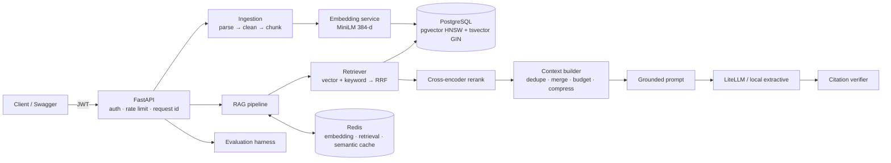

# Enterprise RAG Intelligence Platform

A production-oriented Retrieval-Augmented Generation backend: upload PDF / DOCX / TXT documents, index them into PostgreSQL + pgvector, and ask questions that are answered **only** from your documents, with **verified citations** (document, page, chunk, retrieval scores) — or an explicit *"I could not find sufficient evidence"*.

Runs fully **locally and free** (CPU models, no API key). Plug in OpenAI / Anthropic / Gemini / Ollama through LiteLLM with one setting.

> **Scope.** This build focuses on the AI system — ingestion, retrieval, reranking, context engineering, grounded generation, citation verification and measured evaluation. The interface is the documented REST API (Swagger UI); no web frontend is included.

---

## Highlights

| Area | What is implemented |
|---|---|
| Ingestion | PDF (page-level, font-based heading detection), DOCX (heading styles, tables), TXT/Markdown; magic-byte validation; SHA-256 duplicate detection; atomic re-ingestion |
| Chunking | Fixed / recursive / sentence strategies, **measured in the embedding model's own tokens**, configurable overlap, **section-aware** boundaries, exact char offsets → page ranges, stable content-hash chunk IDs |
| Embeddings | Sentence-Transformers `all-MiniLM-L6-v2` (384-d, CPU), batch encoding, L2 normalisation, **dimension guard** against the pgvector column, Redis query-embedding cache |
| Retrieval | pgvector HNSW cosine search (iterative scan on pgvector ≥ 0.8), PostgreSQL full-text search, **hybrid Reciprocal Rank Fusion**, metadata filters, similarity threshold, PRF and LLM multi-query expansion (opt-in) |
| Reranking | Cross-encoder `ms-marco-MiniLM-L-6-v2` over `top_k × multiplier` candidates |
| Context | De-duplication (exact + near-dup shingles), **adjacent-chunk merging**, token budget, **query-aware compression**, prompt-injection flagging |
| Generation | LiteLLM (timeouts, retries, streaming, token + cost tracking) **or** a local extractive answerer with cross-encoder answerability gating |
| Grounding | Citation markers parsed and **verified** — invented citations removed, per-sentence lexical support scored, uncited claims counted, abstention detected |
| Memory & cache | Conversation memory (recent + relevant older turns), user-scoped retrieval cache with O(1) invalidation, **semantic answer cache** |
| Evaluation | Precision/Recall@k, MRR, nDCG, faithfulness, answer & context relevance, citation precision, abstention, latency, tokens — JSON/CSV reports, ablations, held-out validation |
| Platform | FastAPI, async SQLAlchemy, Alembic, JWT auth + revocation, rate limiting, request IDs, structured logs, Prometheus metrics, Docker Compose |

## Measured results (local mode, CPU)

Sample corpus: 7 documents (PDF/DOCX/TXT, 44 chunks) · dev set of 34 labelled questions (31 answerable, 3 unanswerable) + held-out set of 11 (4 / 7) · k = 3 · API in Docker Desktop on an Intel i5-1135G7 laptop, CPU only. Two consecutive runs produced identical quality metrics.

| Retrieval configuration | MRR | nDCG@3 | Paraphrase MRR (n=10) | Direct MRR (n=14) | p50 / p95 latency |
|---|---:|---:|---:|---:|---:|
| Keyword (PostgreSQL FTS) | 0.930 | 0.894 | 0.783 | 1.000 | 6 / 9 ms |
| Vector (pgvector HNSW) | 0.952 | 0.910 | 0.900 | 0.964 | 6 / 9 ms |
| **Hybrid (RRF)** | **1.000** | **0.945** | **1.000** | **1.000** | 11 / 13 ms |
| Hybrid + PRF expansion | 0.930 | 0.894 | 0.950 | 0.917 | 9 / 12 ms |
| Hybrid + cross-encoder rerank | 0.984 | 0.933 | 0.950 | 1.000 | 297 / 559 ms |

| End-to-end (hybrid + rerank, local answerer) | Dev set | Held-out set |
|---|---:|---:|
| Faithfulness (lexical support of answer sentences) | 1.000 | 1.000 |
| Citation precision (cited source is relevant) | 0.799 | 1.000 |
| Citation validity (no invented markers) | 1.000 | 1.000 |
| Answer rate on answerable questions | 0.774 | 0.750 |
| Abstention accuracy on unanswerable questions | 1.000 (3/3) | **0.714 (5/7)** |
| End-to-end latency p50 / p95 | 583 / 826 ms | 250 / 607 ms |

What the numbers say:

- **Hybrid retrieval wins because the two retrievers fail differently**: keyword search is perfect on direct wording but weak on paraphrases (0.783); vector search is the reverse. RRF fusion gets both right.
- **The cross-encoder did not improve ranking on this corpus** (it demotes one paraphrase that needs reasoning: "three years" ∈ "two to five years") and costs ~290 ms on CPU. It stays enabled by default because its sentence-level scores drive the local answerer's abstention gate and rerankers typically matter more on larger corpora — measure on yours.
- **PRF query expansion hurt** (0.930 vs 1.000) and is therefore opt-in.
- Hit@3 and Recall@3 are 1.000 everywhere — this small corpus saturates them — so MRR/nDCG are the discriminating metrics.
- The abstention threshold was chosen on the dev set, then validated on a held-out set written beforehand; the held-out drop is reported as-is.

Methodology, iteration history and failure analysis: [docs/EVALUATION.md](docs/EVALUATION.md).

## Architecture



Details: [ARCHITECTURE.md](ARCHITECTURE.md) · AI engineering report: [IMPLEMENTATION_REPORT.md](IMPLEMENTATION_REPORT.md)

## Quick start (Windows PowerShell)

Prerequisites: Python 3.13, Docker Desktop, Git.

```powershell
# 1. Infrastructure (PostgreSQL 16 + pgvector on :5442, Redis on :6380) — run in the repo root
docker compose up -d postgres redis

# 2. Backend environment — run in .\backend
cd backend
py -3.13 -m venv .venv
.\.venv\Scripts\python.exe -m pip install torch --index-url https://download.pytorch.org/whl/cpu
.\.venv\Scripts\python.exe -m pip install -r requirements-dev.txt
Copy-Item .env.example .env        # then set JWT_SECRET_KEY (see below)
.\.venv\Scripts\python.exe -c "import secrets; print(secrets.token_urlsafe(64))"

# 3. Database schema
.\.venv\Scripts\alembic.exe upgrade head

# 4. Run the API (first start downloads ~180 MB of models)
.\.venv\Scripts\python.exe -m uvicorn app.main:app --port 8001
```

Open **http://localhost:8001/api/v1/docs**, register via `POST /auth/register`, click **Authorize** (email as username), upload a document and ask a question.

**Full stack in Docker** (API + Postgres + Redis): `docker compose up -d --build` from the repo root (API on :8001; migrations run automatically).

## Using an LLM provider

The default `LLM_DEFAULT_MODEL=local` costs nothing. To use a hosted model, add its key to `backend/.env` and select it per user via `PUT /api/v1/settings {"llm_model": "gpt-4o-mini"}` or per request (`"model"` in the chat body). Allowed models are whitelisted by `LLM_ALLOWED_MODELS`.

| Model string | Credential |
|---|---|
| `gpt-4o-mini` | `OPENAI_API_KEY` |
| `anthropic/claude-haiku-5-5` | `ANTHROPIC_API_KEY` |
| `gemini/gemini-2.0-flash` | `GEMINI_API_KEY` |
| `ollama/llama3.2` | running Ollama + `OLLAMA_API_BASE` |

## API overview

All endpoints are under `/api/v1` and documented in Swagger (`/api/v1/docs`).

| Area | Endpoints |
|---|---|
| Auth | `POST /auth/register`, `POST /auth/login`, `POST /auth/token` (OAuth2 form), `GET /auth/me`, `POST /auth/logout` |
| Health | `GET /health`, `GET /health/ready`, `GET /metrics` (admin) |
| Documents | `POST /documents/upload`, `GET /documents`, `GET /documents/{id}`, `GET /documents/{id}/status`, `GET /documents/{id}/chunks`, `POST /documents/{id}/ingest`, `DELETE /documents/{id}` |
| Search | `POST /search` (`debug: true` returns every pipeline stage), `GET /search/history` |
| Chat | `POST /chat`, `POST /chat/stream` (SSE), `GET /conversations`, `GET /conversations/{id}`, `DELETE /conversations/{id}` |
| Settings | `GET /settings`, `PUT /settings`, `GET /models` |
| Evaluation | `POST /evaluation/run`, `GET /evaluation/results`, `GET /evaluation/results/{id}` |
| Analytics | `GET /analytics/overview`, `GET /analytics/usage` |

Example — ask a question:

```powershell
$h = @{ Authorization = "Bearer $token" }
Invoke-RestMethod -Method Post http://localhost:8001/api/v1/chat -Headers $h -ContentType "application/json" `
  -Body '{"message": "What torque should the DC terminals of the SI-5000 inverter be tightened to?"}'
```

```json
{
  "answer": "Based on your documents:\n\n- Once per year, tighten all DC terminals to a torque of 2.5 Nm and all AC terminals to a torque of 4.0 Nm using a calibrated torque wrench. [1]",
  "citations": [
    {
      "index": 1,
      "document_id": "cd20abd7…",
      "filename": "si5000_inverter_manual.pdf",
      "chunk_id": "ac8175c3…",
      "chunk_ids": [
        "ac8175c3…"
      ],
      "page_number": 3,
      "page_end": 3,
      "section": "Annual Electrical Inspection",
      "text": "Once per year, tighten all DC terminals to a torque of 2.5 Nm and all AC terminals to a torque of 4.0 Nm using a calibrated torque wrench.",
      "retrieval_score": 0.032787,
      "rerank_score": 5.4526,
      "vector_score": 0.6114,
      "support_score": 1.0
    }
  ],
  "insufficient_evidence": false,
  "verification": {
    "invalid_markers_removed": [],
    "uncited_sentences": 0,
    "weakly_supported_sentences": 0,
    "grounding_score": 1.0,
    "insufficient_evidence": false,
    "citation_count": 1,
    "grounded": true,
    "generator": {
      "scorer": "cross-encoder",
      "answerability": 5.0186,
      "threshold": 1.0
    }
  },
  "usage": {
    "prompt_tokens": 0,
    "completion_tokens": 0,
    "total_tokens": 0,
    "context_tokens": 234,
    "cost_usd": 0.0
  },
  "timings_ms": {
    "retrieval": 389.52,
    "context": 2.11,
    "generation": 339.9,
    "total": 739.21
  }
}
```

An unanswerable question (the manual never states the weight):

```json
{
  "answer": "I could not find sufficient evidence in your documents to answer this question.",
  "citations": [],
  "insufficient_evidence": true,
  "verification": {
    "generator": {
      "scorer": "cross-encoder",
      "answerability": -0.3585,
      "threshold": 1.0
    }
  }
}
```

(Real responses captured from the Docker deployment; ids truncated.)

## Testing

```powershell
# run in .\backend (needs the compose Postgres + Redis running)
.\.venv\Scripts\python.exe -m pytest                               # 114 tests: unit + integration
$env:RUN_MODEL_TESTS="1"; .\.venv\Scripts\python.exe -m pytest     # all 120, incl. 6 on the real models
.\.venv\Scripts\python.exe -m pytest --cov=app --cov-report=term   # coverage (94% with model tests)
.\.venv\Scripts\ruff.exe check app tests
```

Integration tests run against a real PostgreSQL + pgvector database (`rag_test`) and real Redis (DB 15) — never SQLite. See [TEST_REPORT.md](TEST_REPORT.md).

## Evaluation

```powershell
# run in the repo root, with the API running on :8001
backend\.venv\Scripts\python.exe evaluation\scripts\run_evaluation.py --k 3
backend\.venv\Scripts\python.exe evaluation\scripts\run_evaluation.py --k 3 --skip-ablation --dataset evaluation\datasets\sample_qa_holdout.json
```

Writes `evaluation/results/<timestamp>_report.json`, `_summary.csv` and `_items.csv`.

## Configuration

All settings are environment variables (see [`backend/.env.example`](backend/.env.example), validated by [`app/core/config.py`](backend/app/core/config.py)). Key ones:

| Variable | Default | Meaning |
|---|---|---|
| `EMBEDDING_MODEL` / `EMBEDDING_DIMENSION` | MiniLM-L6-v2 / 384 | must match the migrated vector column |
| `CHUNK_STRATEGY`, `CHUNK_SIZE_TOKENS`, `CHUNK_OVERLAP_TOKENS` | recursive, 200, 40 | size is in embedding-model tokens (≤ 254 for MiniLM) |
| `SEARCH_MODE` | hybrid | vector / keyword / hybrid |
| `RETRIEVAL_TOP_K`, `RETRIEVAL_CANDIDATE_MULTIPLIER` | 5, 4 | final chunks; rerank pool = top_k × multiplier |
| `SIMILARITY_THRESHOLD`, `RERANK_MIN_SCORE` | 0.25, −10 | recall-oriented cut-offs |
| `LOCAL_ANSWER_MIN_LOGIT` | 1.0 | local answerer abstention threshold (calibrated) |
| `QUERY_EXPANSION` | none | none / prf / multi_query |
| `LLM_DEFAULT_MODEL`, `LLM_ALLOWED_MODELS` | local | provider selection |
| `SEMANTIC_CACHE_THRESHOLD` | 0.95 | cosine similarity for semantic answer reuse |

Production mode (`ENVIRONMENT=production`) refuses to start with a weak `JWT_SECRET_KEY` or wildcard CORS.

## Known limitations

- **Abstention in local mode is imperfect** on "near-miss" questions (the entity exists, the requested attribute does not): 5/7 on the held-out set. The cross-encoder measures topical relevance, not answerability. A hosted LLM with the grounded prompt, or a no-answer-aware QA/NLI model, is the recommended production path.
- The local answerer is **extractive** (verbatim, cited sentences) — faithful but not fluent or synthesising.
- Faithfulness/relevance metrics are **local lexical/embedding proxies**, not LLM-judged; RAGAS is not integrated (it requires a paid judge LLM).
- The benchmark corpus is small (44 chunks); Hit/Recall@3 saturate. Results do not transfer to large corpora without re-evaluation.
- Ingestion runs as in-process background tasks; production would use a durable queue (Celery/arq) and object storage.
- No OCR for scanned PDFs; no web frontend in this build.

More: [PROJECT_STATUS.md](PROJECT_STATUS.md) · [SECURITY_CHECKLIST.md](SECURITY_CHECKLIST.md)

## Project layout

```
backend/app/
  api/            routes, dependencies, middleware (errors, request ids)
  core/           config, security (bcrypt, JWT), logging, tokens, text utils
  ingestion/      parsers (pdf/docx/txt), cleaning, chunking, metadata, pipeline
  embeddings/     model abstraction, Sentence-Transformers, service (cache + guards)
  retrieval/      vector, keyword, hybrid (RRF), reranker, query processing, retriever
  rag/            context builder, prompt builder, generation (LiteLLM/local), citations, pipeline
  evaluation/     metrics, runner
  cache/          Redis caches, rate limiter, token revocation
  models/ schemas/ services/ observability/ database/
backend/tests/    unit + integration (+ opt-in real-model tests)
evaluation/       datasets (corpus + QA sets), scripts, results
infrastructure/   Dockerfile, DB init
```
